# Hi there, I'm DiegoC 👋

Backend & Agent Engineer

Hunting for interesting things on GitHub — dream is to become a Kubernetes wizard. I hope the work I do is meaningful, and the code I write is used by more people.

- 🚀 **Open source I've been working on** — [AgentScope](https://github.com/agentscope-ai/agentscope) · [ReMe](https://github.com/agentscope-ai/ReMe) · [Kueue](https://github.com/kubernetes-sigs/kueue)
- 🧠 **Building** — Multi-Agent Collaboration & Agent Memory
- 📚 **Learning** — sandboxes · Kubernetes
- 🎧 **Hobbies** — listening to Stefanie Sun
- 💬 **Ask me anything** — [open an issue](https://github.com/iluv7/iluv7/issues)

  
  

### 🛠️ Tech Stack

  
  
  
  
  
  
  
  

### 📊 GitHub Stats

  

